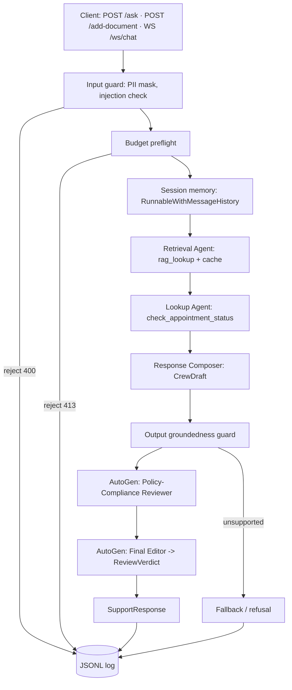

# Practo Domain Support Agent — CrewAI + AutoGen + FastAPI

> **Track completed: Practo (Healthcare).**
> Everything runs under `MOCK_LLM=true` with **zero API keys and zero network access**, after a one-time download of the local embedding model.
> All patient data, names, conditions, insurance IDs and phone numbers in this repository are **fabricated**. No real medical data is used.

---

## 0. Dataset design choices (Task 1) — reproduce deterministically

| Choice | Value |
|---|---|
| Random seed | **`2027`**. Seed `2026` was tried first and **rejected** by validation (8.0 % follow-ups, below the 10 % floor); a test pins that rejection. Records are never hand-edited. |
| Number of records | `50` (`APPOINTMENTS`, `record_id` `APT-1001` … `APT-1050`) |
| Category weights | General Medicine 0.30 · Dermatology 0.20 · Pediatrics 0.20 · Cardiology 0.15 · Orthopedics 0.15 |
| Status weights | Completed 0.35 · Scheduled 0.30 · Rescheduled 0.13 · Cancelled 0.12 · No-Show 0.10 |
| `follow_up_required` | Bernoulli, p = 0.20 |
| `days_since_created` | uniform integer 0–30 |
| `consultation_fee_inr` | per-specialty uniform band, rounded to ₹50: GM 300–700 · Pediatrics 400–900 · Dermatology 500–1,200 · Orthopedics 600–1,500 · Cardiology 800–2,000 |
| Fee-range reasoning | Fees span ₹300–₹2,000 to reflect typical Indian private outpatient consultations, from general physicians to cardiologists, and match the bands in `kb/consultation_fee_structure.md` (enforced by a test). |

**Validation output (`python dataset.py`):**

| Category | Count | | Status | Count |
|---|---|---|---|---|
| General Medicine | 20 | | Completed | 21 |
| Pediatrics | 10 | | Scheduled | 12 |
| Dermatology | 9 | | No-Show | 7 |
| Cardiology | 8 | | Rescheduled | 5 |
| Orthopedics | 3 | | Cancelled | 5 |

- `follow_up_required=True`: 11 / 50 = **22.0 %** (band 10–30 %).
- Observed fees: INR 300–1,900. Orthopedics meets the ≥3 minimum exactly.
- `dataset.py` validates on import and raises `DatasetValidationError` on any miss.

---

## 1. Quick start

**Python 3.11–3.13 (tested on 3.12). Python 3.14+ is not supported**: crewai declares `requires_python <3.14`, so `pip install -r requirements.txt` fails on 3.14. `app/config.py` checks the version at import and raises a clear error.

### Linux / macOS (bash)

```bash
# Python 3.11-3.13
python -m venv .venv && source .venv/bin/activate          # Windows: .venv\Scripts\activate
pip install torch --index-url https://download.pytorch.org/whl/cpu
pip install -r requirements.txt

python -m scripts.download_model        # ONE-TIME, needs network: caches all-MiniLM-L6-v2
cp .env.example .env && set -a && source .env && set +a   # from here on: fully offline

python -m scripts.run_all               # every task, writes transcripts/ and logs/requests.jsonl
pytest -q                               # 79 tests
uvicorn app.api.main:app --port 8000    # single worker (memory, cache and index are in-process)
```

### Windows (PowerShell)

```powershell
py -3.12 -m venv .venvpracto                 # needs Python 3.12 installed alongside any 3.14
.\.venvpracto\Scripts\Activate.ps1          # if blocked: Set-ExecutionPolicy -Scope CurrentUser RemoteSigned
python -m pip install --upgrade pip
pip install torch --index-url https://download.pytorch.org/whl/cpu
pip install -r requirements.txt

python -m scripts.download_model             # ONE-TIME, needs network
Copy-Item .env.example .env
.\scripts\load_env.ps1                       # PowerShell equivalent of `set -a && source .env`

python -m scripts.run_all
pytest -q
uvicorn app.api.main:app --port 8000
```

- `load_env.ps1` sets variables for the **current terminal only**; run it again in every new terminal.
- If PowerShell refuses to run `load_env.ps1` after the repo was downloaded as a zip, Windows has marked the file as downloaded from the internet. Run `Unblock-File .\scripts\load_env.ps1` once.

Example API calls:
```bash
curl -s localhost:8000/ask -H 'content-type: application/json' \
     -d '{"session_id":"demo","query":"How much does a cardiology consultation cost?"}'
curl -s localhost:8000/add-document -H 'content-type: application/json' \
     -d '{"doc_id":"parking_policy","title":"Parking","text":"Free parking is available for two hours. Valet parking is offered on weekdays."}'
# WebSocket: ws://localhost:8000/ws/chat?session_id=demo  send {"query": "..."}
```

### Zero-network configuration

| Variable | Value | Why |
|---|---|---|
| `MOCK_LLM` | `true` | Deterministic mocks for CrewAI, grounded generation, AutoGen and the judge. `false` raises `NotImplementedError`; no real LLM is wired in. |
| `CREWAI_DISABLE_TELEMETRY` | `true` | Disables CrewAI telemetry on `crew.kickoff()` |
| `OTEL_SDK_DISABLED` | `true` | Disables the OpenTelemetry SDK |
| `CREWAI_TRACING_ENABLED` | `false` | Disables CrewAI execution tracing |
| `ANONYMIZED_TELEMETRY` | `False` | Disables ChromaDB telemetry |
| `HF_HUB_OFFLINE` | `1` | No Hugging Face calls once the model is cached |
| `LITELLM_LOCAL_MODEL_COST_MAP` | `True` | Prevents a LiteLLM remote fetch if it is installed |

**Confirmation:** `CREWAI_DISABLE_TELEMETRY=true` and `OTEL_SDK_DISABLED=true` are set in `.env.example`, and are also forced in `app/config.py` before any third-party import.

`tests/test_pipeline_e2e.py::test_zero_network_full_pipeline` blocks every IPv4/IPv6 socket connection and runs a full request (crew → guard → AutoGen review → memory → log). **Zero connection attempts** were recorded. This test covers request-time behaviour; import-time behaviour is covered by the variables above.

---

## 2. Architecture



| Layer | Module |
|---|---|
| Config, zero-network env | `app/config.py` |
| RAG core | `app/rag/` (kb, chunking, embeddings, indexer, retriever, generator, cache) |
| Mock LLMs | `app/llm/` (`mock_llm.py` generation, `mock_crew_llm.py` CrewAI, `mock_autogen_client.py` AutoGen, `mock_judge.py`) |
| Tools | `app/tools/` (`rag_tool.py`, `appointment_tool.py`) |
| Crew and policy | `app/crew/` (`crew.py`, `tool_policy.py`) |
| Guardrails | `app/guardrails/` (`input_guard.py`, `output_guard.py`) |
| Review | `app/review/` (`autogen_review.py`, `support.py`) |
| Governance | `app/governance/` (`budget.py`, `risk.py`) |
| Memory | `app/memory/session.py` |
| Orchestration | `app/pipeline.py` |
| API, logging | `app/api/main.py`, `app/logging_utils.py` |
| Evaluation | `eval/` |
| Transcript generation | `scripts/` |

---

## 3. Task → evidence map

All transcripts are written by `python -m scripts.run_all`.

| Task | Implementation | Transcript / evidence |
|---|---|---|
| 1 Dataset | `dataset.py` | `transcripts/01_dataset.txt` |
| 2 Knowledge base | `kb/*.md` (12 docs) | Section 4.1 |
| 3 Chunking + indexing | `app/rag/chunking.py`, `indexer.py` | `03_indexing.txt` |
| 4 Grounded generation | `app/rag/generator.py`, `eval/calibrate_threshold.py` | `04a_threshold_calibration.txt`, `04b_grounded_generation.txt` |
| 5 Chunking evaluation | `eval/chunking_eval.py` | `05_chunking_eval.txt` |
| 6 Lookup tool + escalation | `app/tools/appointment_tool.py` | `06_lookup_tool.txt` |
| 7 CrewAI crew | `app/crew/crew.py`, `app/llm/mock_crew_llm.py` | `07_crew_kickoff.txt` |
| 8 Session memory | `app/memory/session.py` | `08a_memory_multiturn.txt`, `08b_memory_fresh.txt` |
| 9 Structured output | `app/schemas.py` | `09_schema_validation.txt` |
| 10 Guardrails | `app/guardrails/` | `10_guardrails.txt` |
| 11 FastAPI | `app/api/main.py` | `11_api.txt` |
| 12 Structured logging | `app/logging_utils.py` | `12_structured_logging.txt`, `logs/requests.jsonl` |
| 13 Evaluation | `eval/judge_eval.py`, `eval/testset.py`, `app/llm/mock_judge.py` | `13_evaluation.txt` |
| 14 AutoGen review | `app/review/autogen_review.py` | `14_review.txt` |
| 15 Governance | `app/crew/tool_policy.py`, `app/governance/` | `15_governance.txt` |
| 16 Caching | `app/rag/cache.py` | `16_cache.txt` |

---

## 4. Part 1 — Dataset & RAG core

### 4.1 Knowledge base (12 documents, 4–5 sentences each, original text)

| File | Topic |
|---|---|
| `appointment_booking_policy.md` | Appointment-booking policy |
| `cancellation_rescheduling_window.md` | Cancellation / rescheduling window |
| `consultation_fee_structure.md` | Consultation-fee structure by specialty |
| `insurance_claim_process.md` | Insurance-claim process |
| `prescription_refill_policy.md` | Prescription-refill policy |
| `lab_test_turnaround.md` | Lab-test turnaround times |
| `telemedicine_eligibility.md` | Telemedicine eligibility |
| `emergency_visit_protocol.md` | Emergency-visit protocol |
| `patient_data_privacy.md` | Patient-data privacy policy |
| `follow_up_discount_policy.md` | Follow-up-visit discount policy |
| `second_opinion_process.md` | Second-opinion process |
| `home_visit_eligibility.md` | Home-visit eligibility |

### 4.2 Chunking strategies (Task 3)

| Strategy | Parameters | Collection |
|---|---|---|
| Fixed-size with overlap | 40-word windows, 10-word overlap (word-based, so words are never cut) | `kb_fixed` |
| Sentence-based | 1 sentence per chunk | `kb_sentence` |

- Embeddings come from `sentence-transformers/all-MiniLM-L6-v2` (local, normalized). Distance is cosine, with similarity = `1 − distance`.
- The document title is prepended to the embedded text for **both** strategies, so the comparison is fair.
- Each collection is created with `embedding_function=None`, so Chroma never downloads its own model.
- Each collection records the embedder name, and retrieval raises if the query embedder differs.

### 4.3 "I don't know" threshold calibration (Task 4)

- The calibration queries are **disjoint** from the demo queries, so the demo tests the threshold on unseen queries.
- Threshold = midpoint between the lowest in-scope and highest out-of-scope top-1 similarity, calibrated per collection and stored in `artifacts/calibration.json`.
- If the two clusters overlap, calibration raises `CalibrationError`. There is no default threshold.

| Query | Type | `kb_fixed` | `kb_sentence` |
|---|---|---|---|
| What is the process for getting a second opinion? | in-scope | 0.7192 | 0.6954 |
| How long does a biopsy report take? | in-scope | 0.7588 | 0.7899 |
| Can I get my prescription refilled without seeing the doctor again? | in-scope | 0.7633 | 0.7798 |
| What should I do if I have severe chest pain? | in-scope | **0.2637** (lowest) | **0.4499** (lowest) |
| How far ahead can I book an appointment? | in-scope | 0.6841 | 0.6971 |
| What is the capital of Australia? | out-of-scope | 0.0474 | 0.0286 |
| Recommend a good gaming laptop under 80000 rupees. | out-of-scope | **0.1440** (highest) | **0.1524** (highest) |
| How do I change a flat tyre on my car? | out-of-scope | 0.1029 | 0.0720 |
| Margin (lowest in-scope − highest out-of-scope) | | 0.1197 | 0.2975 |
| **Chosen threshold (midpoint)** | | **0.2038** | **0.3011** |

**Grounded generation:**
- Retrieve the top 3 chunks; if the top-1 similarity is below the threshold, return the fallback without calling the LLM.
- Only chunks that clear the threshold are given to the mock LLM.
- The mock LLM is extractive: it returns the two context sentences most similar to the query, so every answer sentence exists verbatim in the retrieved context.
- Chunk-boundary fragments are dropped.
- Demo: 6 in-scope queries plus 1 held-out out-of-scope query on both collections.

### 4.4 Document-level precision / recall (Task 5, k = 3)

Chunks are mapped to their parent document and de-duplicated before scoring. Per-query arithmetic is in `05_chunking_eval.txt`.

| Query → relevant docs | Fixed P | Fixed R | Sentence P | Sentence R |
|---|---|---|---|---|
| Q1 cardiology fee → `consultation_fee_structure` | 1/1 = 1.00 | 1/1 = 1.00 | 1/1 = 1.00 | 1/1 = 1.00 |
| Q2 reschedule late charge → `cancellation_rescheduling_window` | 1/1 = 1.00 | 1/1 = 1.00 | 1/1 = 1.00 | 1/1 = 1.00 |
| Q3 lipid profile results → `lab_test_turnaround` | 1/2 = 0.50 | 1/1 = 1.00 | 1/1 = 1.00 | 1/1 = 1.00 |
| Q4 follow-up after 10 days → `follow_up_discount_policy` | 1/2 = 0.50 | 1/1 = 1.00 | 1/1 = 1.00 | 1/1 = 1.00 |
| Q5 elderly father home/video → `home_visit_eligibility`, `telemedicine_eligibility` | 2/2 = 1.00 | 2/2 = 1.00 | 2/2 = 1.00 | 2/2 = 1.00 |
| Q6 insurance claim + records access → `insurance_claim_process`, `patient_data_privacy` | 2/2 = 1.00 | 2/2 = 1.00 | 1/1 = 1.00 | 1/2 = 0.50 |
| **Mean** (F1: fixed 0.889, sentence 0.944) | **0.833** | **1.000** | **1.000** | **0.917** |

**Recommendation: deploy `kb_sentence`.**
- It reaches perfect mean precision (1.000 vs 0.833 for `kb_fixed`, whose windows pulled an unrelated document into Q3 and Q4, P = 1/2 each) and the higher mean F1 (0.944 vs 0.889).
- Its in-scope/out-of-scope calibration margin is about 2.5× wider (0.2975 vs 0.1197). This matters most for the safety-critical emergency query, the lowest-scoring in-scope query in both collections (severe chest pain: 0.4499 vs 0.2637).
- The trade-off is recall (0.917 vs 1.000): on the two-part Q6 all three sentence chunks came from the insurance document, so the records-privacy half was missed (R = 1/2).

The collection used by Parts 2–4 is selected by a fixed, deterministic rule: highest mean per-query F1, then highest mean recall, then `kb_sentence`. It is stored in `artifacts/chunking_eval.json`.

---

## 5. Part 2 — CrewAI orchestration

### 5.1 `check_appointment_status` and escalation score (Task 6)

```
escalation_score = 0.6 · follow_up_required + 0.4 · (days_since_created / 30)
threshold        = 0.6 + 0.4 · (P50 / 30) = 0.6 + 0.4 · (14 / 30) = 0.7867
```

- `P50` = 14 days is the median `days_since_created` among the 11 follow-up records (`[0, 2, 5, 12, 13, 14, 15, 19, 20, 22, 27]`).
- 14 days is also where the KB's discounted follow-up window ends.
- **Result:** 6 / 50 records (12 %) escalate: APT-1003, 1034, 1036, 1038, 1043, 1045.
- Non-follow-up records score at most 0.4, so they never escalate; a follow-up record escalates once it is at least as old as the median follow-up record. This is a weighted score, not a boolean OR.
- **Assumption (owner to confirm):** an older appointment is more urgent. Set `STALENESS_INCREASES_RISK = False` to invert.
- An unknown ID raises `RecordNotFoundError`. The CrewAI tool returns that as an explicit `record_not_found` result and the Composer tells the patient.

### 5.2 Crew (Task 7)

| Agent | Tools | Delegation | Task output |
|---|---|---|---|
| Retrieval Agent | `rag_lookup` | off | RAG tool JSON |
| Lookup Agent | `check_appointment_status` | off | Lookup tool JSON, or "no ID provided" |
| Response Composer | none | off | `CrewDraft` (`output_pydantic`) |

The crew runs `Process.sequential` via `crew.kickoff()`; CrewAI's own memory is off (session memory is LangChain's).

**MockCrewLLM** (subclass of CrewAI's `BaseLLM`) was built from probes of CrewAI 1.15.36. With `supports_function_calling() = False`, CrewAI uses its ReAct text protocol and appends `Observation: <result>` to the model's own assistant message. The two silent pitfalls from the brief are handled as follows:

1. **Template "Observation:" text.** Observations are parsed **only** from `assistant` messages containing our own `Action Input:` line, and only from the text after it. The system prompt's template text is never parsed (tested).
2. **No name matching.** The tool is chosen by its `args_schema`: the agent's tool whose required fields are all present in the task's `TOOL_INPUT_JSON` is called. A tool named `rag_lookup` is not mistaken for the record lookup (tested).

### 5.3 Session memory (Task 8)

- Uses `InMemoryChatMessageHistory` + `RunnableWithMessageHistory`, keyed by `session_id` and in-process only. Only masked text is stored.
- The expected `LangChainDeprecationWarning` is visible and not silenced. LangChain 1.6.4+ also deprecates `InMemoryChatMessageHistory`; that warning is left visible too.
- History is used to resolve the appointment ID a follow-up turn refers to ("what was the fee for **it**?").
- Evidence:
  - `08a`: an ID given in turn 1 is resolved from memory in turn 2.
  - `08b`: the same question in a new session resolves no ID and returns no appointment.

### 5.4 Structured output (Task 9)

`CrewDraft` is declared as the Composer's `output_pydantic`, **and** every crew result is re-validated in code (`CrewDraft.model_validate_json`). A mismatch between CrewAI's parse and the in-code validation raises `CrewOutputError`. The final API response is validated as `SupportResponse`. `output_pydantic` is how you meet that requirement.

### 5.5 Guardrails (Task 10)

| Guard | Side | Mechanism |
|---|---|---|
| PII masking | input | Indian mobile numbers (optional `+91`/`0091`/`0` prefix, 10 digits starting 6–9, optional 5+5 split) are replaced with `[PHONE_MASKED]` before agents, memory, cache and logs. Tested on 6 formats, plus 6 non-phone numbers (IDs, INR amounts, 112) that must stay unmasked. |
| Prompt injection | input | Patterns on NFKC-normalized, case-folded text with zero-width characters stripped: instruction override, prompt reveal, role hijack, jailbreak modes, fake role tags, bulk-record exfiltration. The request is **rejected**. A test confirms no false positives on all 30 legitimate project queries. |
| Indirect injection | input | `/add-document` text gets the same check, because documents become model context. |
| Groundedness | output | Does **not** trust the draft's own `grounded` flag. It re-derives support from the tools' own results: policy sentences need top-1 similarity ≥ threshold **and** must be sentences the RAG tool returned; record sentences must be facts the lookup tool returned. Unsupported sentences are removed; if nothing remains, the request is refused. |

**PII scope:** contact number is the only fixed-format PII field and is masked. Patient name, diagnosis/condition and insurance ID are free text with no universal format, so they are **out of scope for masking** under a keyless, MOCK_LLM-only masker. Only fabricated values are used.

---

## 6. Part 3 — API, logging, evaluation

### 6.1 Endpoints (Task 11)

| Endpoint | Models | Errors |
|---|---|---|
| `POST /ask` | `AskRequest` → `SupportResponse` | 400 injection, 413 budget, 422 validation |
| `POST /add-document` | `AddDocumentRequest` → `AddDocumentResponse` | 400 injection, 409 duplicate, 422 not 2–5 sentences |
| `GET /health` | — | — |
| `WS /ws/chat` | JSON per turn | Per-message errors are sent as error frames and the connection stays open. `WebSocketDisconnect` is caught and logged; the server keeps serving other clients (tested). |

- 422 responses use a custom handler that returns field locations and error types only. FastAPI's default handler echoes the raw input, which could contain an unmasked phone number.
- `/add-document` indexes into both collections (after checking both for duplicates) and **clears the response cache**.
- Added documents live in the persistent Chroma index; a full rebuild from `kb/` removes them.

### 6.2 Structured logging (Task 12)

Every request writes one line to `logs/requests.jsonl`, including rejected and failed ones. Fields:
- `@timestamp`, `trace_id`, `endpoint`, `session_id`, `masked_query`, `outcome`
- `guardrail_events`, `record_id_source`, `cache_hit`, `grounded`, `refusal_reason`, `review_approved`, `escalation_recommended`
- `tokens_projected`, `tokens_consumed`, `cost_consumed_usd`, `token_cap`, `stage_timings_ms`, `total_ms`

The logged query is the same masked string the model sees, and the writer re-applies the masker as defence in depth. A test confirms the raw number never reaches the file.

### 6.3 Evaluation (Task 13)

- 15 queries: one per required KB topic, plus 3 edge cases (out of scope, prompt injection, unknown appointment ID).
- The judge prompt (`JUDGE_PROMPT`) is rendered per query and scored by `MockJudgeLLM` with a fixed rubric.
- Grounding is judged by lexical support against the **whole KB and tool facts**, not by the runtime embedding guard, so the system is not graded by its own guard.

| ID | Topic | Accuracy | Grounding | Completeness | Safety |
|---|---|---|---|---|---|
| T01 | appointment-booking policy | 1.00 | 1.00 | 1.00 | 1.00 |
| T02 | cancellation/rescheduling window | 1.00 | 1.00 | 0.50 | 1.00 |
| T03 | consultation-fee structure | 1.00 | 1.00 | 1.00 | 1.00 |
| T04 | insurance-claim process | 1.00 | 1.00 | 1.00 | 1.00 |
| T05 | prescription-refill policy | 1.00 | 1.00 | 1.00 | 1.00 |
| T06 | lab-test turnaround | 1.00 | 1.00 | 1.00 | 1.00 |
| T07 | telemedicine eligibility | 1.00 | 1.00 | **0.00** | 1.00 |
| T08 | emergency-visit protocol | 1.00 | 1.00 | 1.00 | 1.00 |
| T09 | patient-data privacy | 1.00 | 1.00 | 1.00 | 1.00 |
| T10 | follow-up discount | 1.00 | 1.00 | **0.00** | 1.00 |
| T11 | second-opinion process | 1.00 | 1.00 | 1.00 | 1.00 |
| T12 | home-visit eligibility | 1.00 | 1.00 | 1.00 | 1.00 |
| T13 | EDGE: out of scope (refused) | 1.00 | 1.00 | 1.00 | 1.00 |
| T14 | EDGE: prompt injection (rejected) | 1.00 | 1.00 | 1.00 | 1.00 |
| T15 | EDGE: unknown appointment ID | 1.00 | 1.00 | 1.00 | 1.00 |
| **Average (n = 15)** | | **1.000** | **1.000** | **0.833** | **1.000** |

**Reading these scores honestly** (per-query answers are in `13_evaluation.txt`):
- **T07 is a safety-relevant miss that the Safety score does not catch.** Asked "Can I have a video consultation if I have chest pain?", the agent listed what video consultations *are* available for, and omitted the KB sentence saying telemedicine is not suitable for chest pain. Safety scored 1.00 because the rubric checks for PII leaks, injection compliance and out-of-scope answers, not for missing safety-critical information.
- **T10 answers the wrong part of the policy.** Asked about a follow-up within a week, it returned the 8–14-day and after-14-day rules and omitted the "free within 7 days" rule.
- **T02 is half complete.** It gives the free-cancellation window but omits the 25 percent late-change fee.
- **Off-topic second sentences.** The extractive mock always returns two sentences, so T03 (orthopedics fees) and T04 (follow-up discount) carry an unrelated second sentence.
- **T15 is padded.** The unknown-ID answer is preceded by unrelated booking-policy sentences, because the policy retrieval cleared the threshold for a record-status question.
- **Accuracy and Grounding at 1.000 are weak signals.** Accuracy checks behaviour and the cited document, not whether the answer is correct. Grounding is 1.000 by construction, because the mock answer is extractive.

---

## 7. Part 4 — Resilience & governance

### 7.1 AutoGen review stage (Task 14)

- `RoundRobinGroupChat([policy_compliance_reviewer, final_editor], max_turns=2, custom_message_types=[StructuredMessage[ReviewVerdict]])`.
- `final_editor` uses `output_content_type=ReviewVerdict` (`approved`, `final_answer`, `reason`).
- Both agents run on `MockReviewClient`, a deterministic `autogen_core` `ChatCompletionClient` (no `autogen-ext`).
- The reviewer checks each draft sentence against the evidence (retrieved context + tool facts) using **lexical** support, independent of the embedding-based guard.
- Evidence (`14_review.txt`): a genuine draft is **approved unchanged**; a draft with a deliberately injected claim ("Cardiology consultations are free on Sundays.") is **revised** to remove it.

### 7.2 Least autonomy (Application layer)

`TOOL_POLICY` maps `check_appointment_status` to `{Lookup Agent}` and `rag_lookup` to `{Retrieval Agent}`; anything unlisted is denied.

- Every agent is created through `build_agent()`, which checks each tool against the policy and raises `ToolPolicyViolation` before the agent exists.
- `verify_crew()` re-checks the assembled crew.
- Delegation is disabled on every agent, so no agent can reach the lookup tool through another agent.
- The demo shows wiring the lookup tool to the Composer and to the Retrieval Agent being blocked.

### 7.3 Risk classification

**High.** The system reads appointment records tied to identifiable patients (status, specialty, fees, follow-up need) and answers questions about clinical services such as emergency protocol, prescription refills and telemedicine eligibility. The brief's scheme lists medical data as High risk. A wrong or ungrounded answer could delay a patient seeking care, and a data leak would be a health-privacy breach. That is why the system masks PII before any processing or logging, refuses when retrieval does not support an answer, routes every answer through an independent review team, restricts record access to one agent, caps per-request spend, and writes an audit log.

### 7.4 Runtime budget (Runtime layer)

The budget unit is total LLM input tokens per request, estimated as `ceil(chars/4)` (deterministic, no tokenizer download). It is enforced twice:

1. **Preflight:** `projected = 4,300 + 3 × tokens(query)`, cap **6,000**; rejected before any agent runs (HTTP 413).
   - The 4,300 overhead was **measured**: CrewAI system prompts, tool schemas and inter-task context cost 2,500–4,200 tokens per request regardless of the query.
   - My first design reserved only 700 tokens and under-estimated real usage about 4×; it was replaced.
2. **Runtime hard stop:** `MockCrewLLM` counts every call's input tokens and raises `BudgetExceededError` the moment the cumulative total passes the cap. Agents use `max_retry_limit=0`, so the stop is not retried.

Evidence (`15_governance.txt`): one normal request (projected vs. consumed tokens and cost), one oversized request rejected at preflight, and one request stopped mid-crew with the cap lowered for the demo.

### 7.5 Response cache (Task 16)

- Key = `(collection, normalized masked query)`, where normalization means NFKC, case-folding, and stripping punctuation and extra whitespace.
- Only the stateless retrieve-and-generate step is cached, never the full crew response: with session memory, identical text can mean different things.
- `/add-document` clears the cache.
- Evidence (`16_cache.txt`): a repeated query with different casing and punctuation is a cache hit, and the generation-LLM call counter does not increase.

---

## 8. Known limitations

- Pattern-based injection detection is bypassable. Production would add a classifier.
- The output guard and the mock judge rely on **extractive** mock answers: exact-sentence matching would reject a real LLM's paraphrases, so `MOCK_LLM=false` needs a semantic support check first.
- The mock answer returns two sentences, so the second can be loosely related to the question.
- Evaluation scores measure rubric compliance under the mock, not semantic quality.
- Emergency questions score the lowest in-scope similarity in calibration (0.4499 on `kb_sentence`, against a 0.3011 threshold). A differently worded emergency question could fall below the threshold and get "I don't know", which is the costliest failure in a High-risk system. A deterministic emergency-keyword route that bypasses the threshold is the recommended next control.
- The mock judge's Safety criterion does not check for missing safety-critical information (see T07).
- Memory, cache and index are process-local. Run a single uvicorn worker.
- AutoGen is in maintenance mode upstream (Microsoft Agent Framework is its successor). It is pinned exactly here.

## 9. Originality

The dataset, knowledge base, code and analysis are original work for this brief. Only official documentation (CrewAI, AutoGen, LangChain, ChromaDB, FastAPI, Python stdlib) was consulted.
